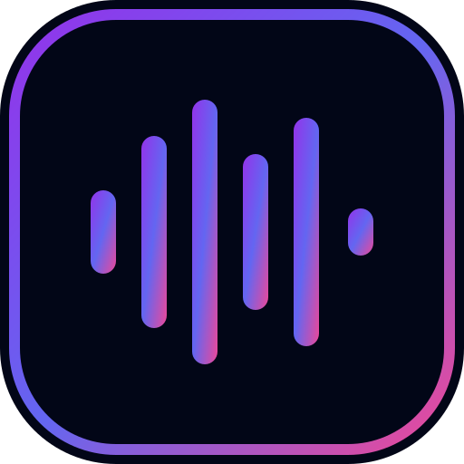

# 🎵 AudioLab (VocalCut Studio)

An all-in-one, privacy-focused, client-side Web Audio Studio & Progressive Web App (PWA). Extract vocals and background music using neural AI, trim/cut/merge audio clips, and extract audio from videos with zero server uploads.



---

## 🚀 Key Features

* **AI Vocal & Background Music Separator**:
  * **Meta HTDemucs AI Mode**: Runs locally via WebGPU/WASM for studio-grade vocal & instrumental isolation. Models cached in IndexedDB for permanent offline access.
  * **Instant Karaoke Filter (DSP Mode)**: 0.1-second center-channel cancellation without any model downloads.
* **Zero-Step Video Ingestion**:
  * Drop any video (`.mp4`, `.webm`, `.mkv`, `.mov`) or audio (`.mp3`, `.wav`, `.aac`, `.flac`).
  * Audio track is extracted automatically in-memory.
* **Studio Audio Editor**:
  * Interactive 60 FPS waveform with selection drag handles.
  * **Trim** & **Cut** regions with millisecond precision.
  * **Merge / Append** another track to the end.
  * **Smooth Fades**: Configurable Fade-In and Fade-Out (0s to 5s).
  * **Volume Boost & Normalize**: Up to 250% gain boost or 98% peak normalization.
  * **Playback Speed**: 0.5x, 0.75x, 1x, 1.25x, 1.5x, 2x tempo presets.
* **Export Engine**:
  * Client-side MP3 encoding (128 kbps, 192 kbps, 320 kbps Studio Quality) via `@breezystack/lamejs`.
  * Lossless 16-bit uncompressed WAV export.
* **PWA (Progressive Web App)**:
  * Installable directly on Android, iOS, Windows, and Mac as a standalone app.
  * Fully offline-capable once installed.

---

## 💻 Local Development

```bash
# 1. Install dependencies
npm install

# 2. Run local development server
npm run dev

# 3. Build for production
npm run build

# 4. Preview production build
npm run preview
```

---

## 🔒 100% Client-Side Privacy

All processing (decoding, editing, AI stem separation, encoding) executes entirely inside your browser's local sandbox using the Web Audio API and WebGPU/WASM. No audio or video data is ever sent to any external server.
